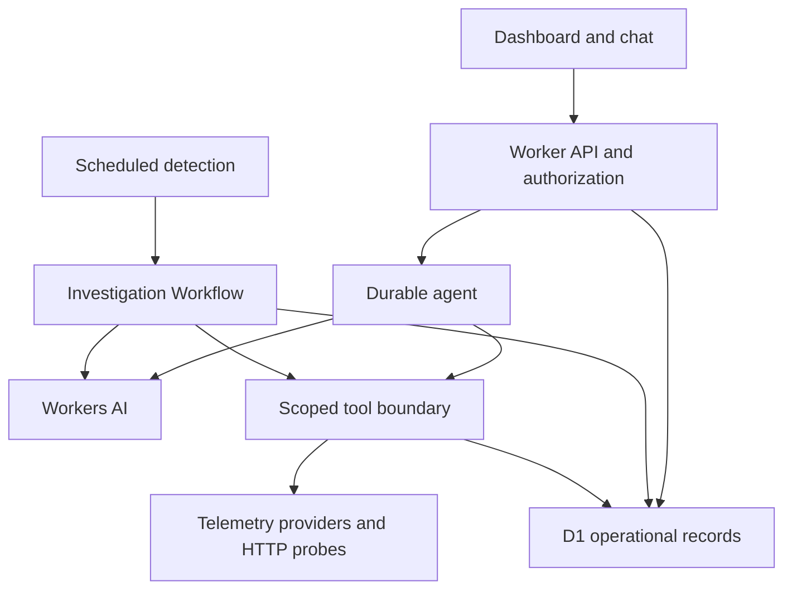

# Architecture

Status: proposed. One bounded agent with typed tools; no multi-agent orchestration.

## Boundaries

Worker API serves static assets and authenticated APIs. Authentication and scope checks precede routing to an agent or workflow; an agent ID is never authorization. Derive agent identity from workspace/application/environment/conversation and verified identity. Evaluator sessions use a separate deployment and isolated state.

The agent owns chat and interactive reasoning. A Workflow owns long-lived investigation execution; chat attaches to the existing investigation rather than starting a second reasoning loop. Workflows persist step results; D1 holds canonical investigation status/evidence for UI reads. Durable Object state contains conversation context and a derived progress view, not a competing incident record.

Cron performs cheap health checks and deterministic detection. Only anomalies or explicit operator questions invoke inference. Use a stable deduplication key and an outbox/reconciliation design to bridge D1 incident creation and Workflow dispatch; no distributed transaction is assumed.

All provider traffic passes through typed adapters with authorization, redaction, timeout, response caps and audit. Never give the model a general HTTP client, shell, arbitrary SQL or production credentials. Return normalized evidence rather than unfiltered provider payloads.

## Runtime decisions

Use TypeScript throughout, React/shadcn/ui on the frontend, Hono routing, Agents SDK on Durable Objects, Workers AI, Workflows and D1. Pin versions and prove their integration in Phase 1 before writing detailed SDK-specific code. Prefer simple D1 history retrieval before adding Vectorize; R2 is optional for large sanitized artifacts.

## Failures and scaling

Store only probe summaries, aggregate telemetry and incident evidence; query raw logs on demand. Bound concurrent probes and page provider queries. Provider 429s retry within a fixed budget; authorization errors do not retry indefinitely. Persist failed/partial states for operator visibility. Reconciliation repairs unsent dispatches and stale progress; writes use idempotency keys and expected versions.

Demo, development and live deployments have different bindings and secrets. Initial live access is one trusted workspace, but every entity and query remains scoped. Additional tenant administration is deferred.

## Verification boundary

Provider documentation supports the selected architectural primitives; it does not prove the user's account permissions, logging retention, hosting topology, or integration endpoints. These remain discovery gates in [TrustPlate onboarding](integrations/TRUSTPLATE.md). See [references](references/SOURCES.md) for current provider sources.
