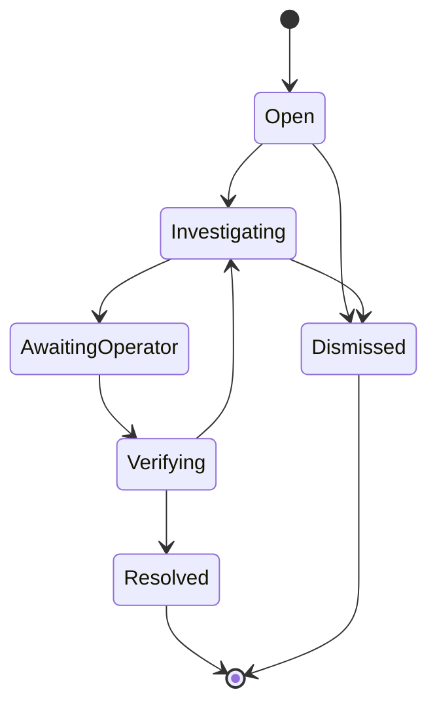

# Incident and investigation lifecycle

Incident status: open → investigating → awaiting_operator → verifying → resolved. Failed verification returns to investigating. Operator may dismiss a false positive with reason. A later recurrence creates a linked new incident. Investigation run status is separate: queued, running, waiting, completed, partial, failed, cancelled.

1. Detect threshold breach using valid windows/sample counts. Claim a scope/service/signal dedupe key, persist incident and dispatch intent.
2. Dispatch Workflow with stable run ID; reconcile dispatch failures from the outbox. Replays return the existing run.
3. Collect independent bounded evidence; provider failures become explicit gaps. Persist sanitized evidence before model access.
4. Retrieve scoped prior incidents/runbooks, preserving confirmation status.
5. Rank hypotheses with the model and allow bounded targeted queries. Persist progress after each completed step.
6. Save findings/recommendations and await operator action. A configurable wait timeout records a pending/manual state rather than resolving the incident.
7. Authenticated operator reports action and asks to verify. Validate event scope, event ID and expected version; reject replayed/stale transitions.
8. Perform three consecutive scheduled successful probes by default and compare available telemetry with baseline. Missing telemetry is disclosed; transport recovery alone cannot confirm a database cause.
9. Resolve with actor, outcome and explicit cause status (confirmed/unknown). Only confirmed lessons enter confirmed memory.

Workflow retry is not exactly-once execution. Every state-changing step needs an idempotency key. Avoid repeating model inference when its validated result is already persisted. Recovery after a partial write uses the saved result, not a new conflicting summary. Set maximum attempts, timeout and total budget per step/run.

Cancellation stops new diagnostic work and records the reason; it does not erase the incident. Only authenticated operator actions change final resolution or confirmation. Scheduled reconciliation detects stuck dispatches and stalled runs without starting duplicate investigations.
